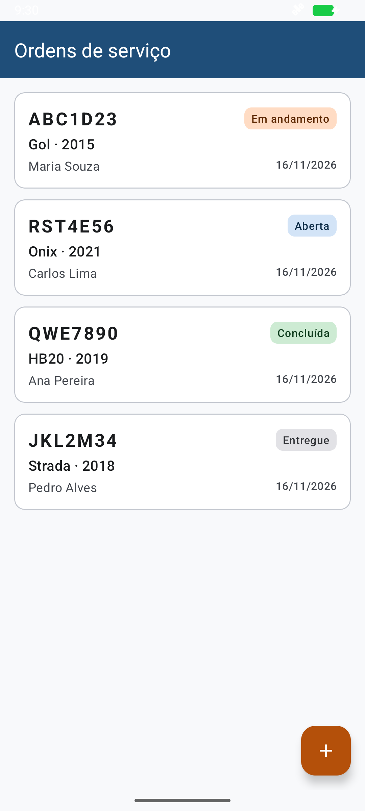
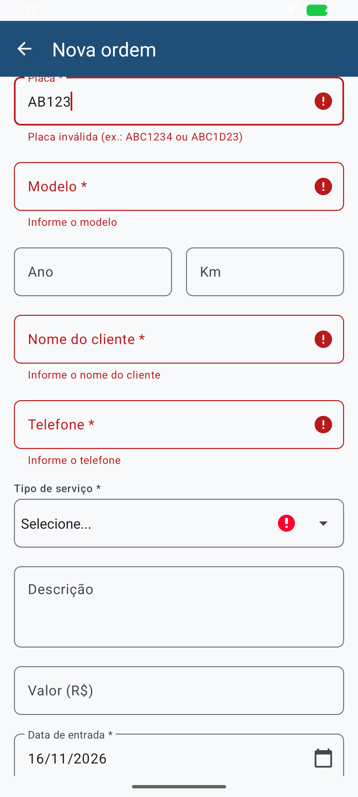
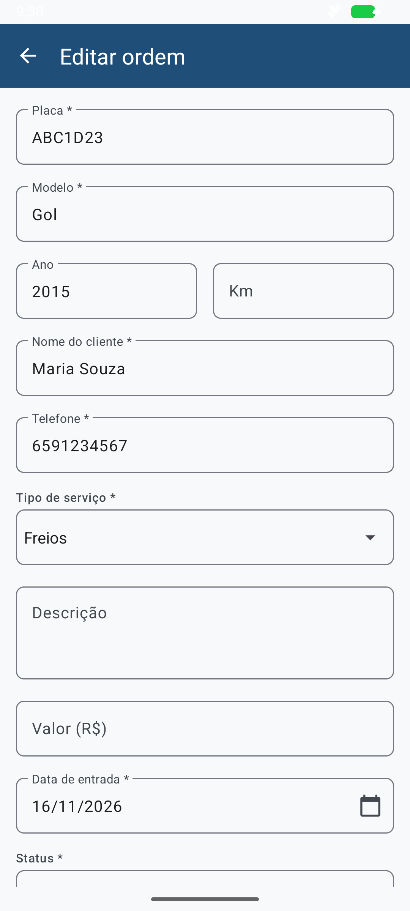

# Oficina — ordens de serviço no Android

App Android para uma oficina mecânica pequena registrar os veículos que entram para serviço: cadastrar, consultar, editar e excluir ordens de serviço, com os dados guardados no próprio aparelho, sem internet.


<p align="center">
  
  &nbsp;
  
  &nbsp;
  
</p>
<p align="center"><sub>Lista de ordens · Validação no cadastro · Edição</sub></p>

## Funcionalidades
- **CRUD completo** de ordens de serviço em SQLite (`SQLiteOpenHelper`, sem ORM).
- **Lista** em cards com placa em destaque, status colorido (Aberta, Em andamento, Concluída, Entregue), mais recente primeiro.
- **Cadastro e edição** com 11 campos: placa, modelo, ano, km, cliente, telefone, tipo de serviço, descrição, valor, data de entrada e status.
- **Validação** campo a campo, com a mensagem embaixo do campo e foco no primeiro erro:
  - placa no padrão antigo e Mercosul (`ABC1234` / `ABC1D23`), normalizada para maiúsculas, sem hífen;
  - telefone com 10 ou 11 dígitos; ano entre 1950 e o ano seguinte; km e valor não negativos;
  - valor aceita vírgula ou ponto como separador decimal.
- **Exclusão com confirmação** e mensagens de retorno para cada operação.
- **Persistência**: os dados continuam lá depois de fechar o app ou forçar a parada.
- **Sistema de design próprio** sobre o Material 3, com contraste mínimo de 4.5:1 e áreas de toque de 48dp.

## Tecnologias
| Área | Escolha |
|---|---|
| Linguagem | Java 11 |
| Plataforma | Android (minSdk 24, targetSdk 37), Activities + layouts XML |
| Banco | SQLite nativo via `SQLiteOpenHelper` |
| Interface | Material Components (Material 3): `TextInputLayout`, `MaterialCardView`, FAB, `MaterialAlertDialog` |
| Build | Gradle (Kotlin DSL), Android Gradle Plugin 9.5 |
| Testes | JUnit 4 (testes locais, sem emulador) + Android Lint |

## Arquitetura
```text
br.edu.fasipe.oficina
├── model/        ServiceOrder: os dados de uma ordem
├── data/         DatabaseHelper (schema) + ServiceOrderDao (CRUD)
├── validation/   ServiceOrderValidator: regras em Java puro, testável sem Android
└── ui/           Activities, adapter da lista e o formulário compartilhado
```
- A camada `ui` nunca acessa o banco diretamente: passa sempre pelo `ServiceOrderDao`.
- O validador não depende de classes Android, então roda em JUnit comum.
- Um teste de arquitetura (`ArchitectureTest`) garante essas fronteiras e limita cada arquivo `.java` a 350 linhas.
- Erros de SQLite são tratados no DAO: o app nunca fecha por falha de banco.

Detalhes e decisões em [docs/architecture.md](docs/architecture.md).

## Qualidade
```bash
./gradlew lint testDebugUnitTest assembleDebug
```
- 11 testes do validador, um para cada regra do produto, e 4 testes de arquitetura.
- Lint sem erros.
- Os critérios de aceite (cadastro, lista, edição, exclusão, persistência e navegação) foram verificados no emulador.

## Como rodar
**Pré-requisito:** [Android Studio](https://developer.android.com/studio), que já traz JDK e Android SDK.

1. Clone o repositório e abra a pasta no Android Studio (**File → Open**).
2. Espere o Gradle Sync terminar.
3. Escolha um emulador ou celular e clique em **Run ▶**.

Pelo terminal, com um emulador aberto:
```bash
./gradlew installDebug
```
No Windows, use `gradlew.bat` no lugar de `./gradlew`. Passo a passo e problemas conhecidos: [docs/onboarding.md](docs/onboarding.md).

## Documentação
| Documento | Conteúdo |
|---|---|
| [PRODUCT.md](PRODUCT.md) | Escopo, campos, regras, mensagens e critérios de aceite |
| [docs/architecture.md](docs/architecture.md) | Estrutura, fronteiras e decisões |
| [docs/design.md](docs/design.md) | Sistema de design: cores, tipografia, componentes |
| [docs/quality.md](docs/quality.md) | Checks e estratégia de testes |
| [docs/onboarding.md](docs/onboarding.md) | Preparação do ambiente |
| [docs/setup.md](docs/setup.md) | Versões reais e evidências |
| [AGENTS.md](AGENTS.md) | Instruções para agentes de IA que trabalham no código |

## Contexto
Projeto acadêmico da Atividade N3 da Faculdade Fasipe (prof. Ibrahin): um app Android em Java com SQLite, CRUD completo e no mínimo 10 campos por registro ([especificação](Especificações%20do%20app%20aura%20+.md)).
Desenvolvido com Git em branches por funcionalidade e Pull Requests, apoiado por agente de IA (Claude Code).

## Licença
[MIT](LICENSE)
